  

 

### Featured projects

### GitHub activity

  
Python · OpenCV · MediaPipe · React · TypeScript · FastAPI · Three.js

  
Мен технологияны білім мен күнделікті өмірге пайдалы ету үшін жобалар жасаймын.

  <a href="https://ansaganakhat.github.io/profile/">Portfolio</a> ·
  <a href="https://github.com/ansaganakhat?tab=repositories">All repositories</a>

<!-- Cards are drawn by scripts/render_cards.py and refreshed by GitHub Actions. -->
